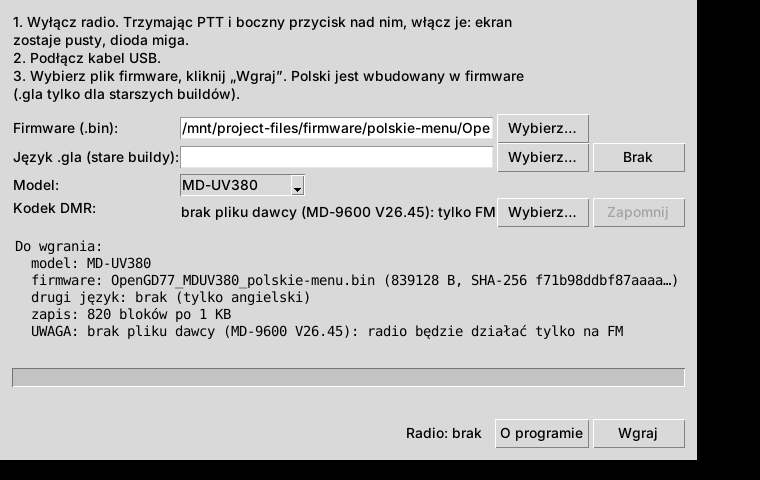

# rt3s-flasher: wgrywanie firmware do Retevis RT3S z Linuksa

Autor: **Greg M0SQQ** ([GregDoma/Retevis-RT3S](https://github.com/GregDoma/Retevis-RT3S)).
Firmware: OpenGD77 i fork SP7TQ (Marcin SP7TQ), kredyty na końcu tej strony.

Natywny program (okno + wiersz poleceń) do wgrywania firmware OpenGD77 / SP7TQ do
**Retevis RT3S / TYT MD-UV380** przez USB. Robi to samo co flasher WebUSB (strona SP7TQ,
`web/js`) i loader OpenGD77 (`MDUV380_firmware/tools/opengd77_stm32_firmware_loader.py`),
ale bez przeglądarki i z komunikatami po polsku:

- rozpoznaje języki wbudowane w firmware; plik `.gla` dokleja tylko do starszych buildów (zob. niżej),
- wkleja kodek AMBE z oryginalnego firmware **MD-9600 V26.45** (plik dawcy, sprawdzany sumą SHA-256),
- szyfruje obraz i zapisuje go przez DFU do bootloadera radia (`0483:df11`, „Digital Radio in USB mode”).



> **Stan testów.** Program **nie był jeszcze uruchomiony na prawdziwym radiu.** Sprawdzone bez
> sprzętu: obraz i kolejność poleceń DFU są bajt w bajt takie jak w loaderze OpenGD77 (testy na
> danych syntetycznych oraz na trzech buildach RT3S z projektu), zapis przez DFU działa na
> symulatorze bootloadera, okno uruchamia się. Kod USB to ta sama sekwencja co w loaderze
> OpenGD77, ale pierwsze wgranie zrób, mając pod ręką sprawdzony sposób (loader OpenGD77 lub
> flasher WebUSB). Bootloader (0x08000000–0x0800BFFF) nie jest kasowany, więc nieudany zapis
> naprawia się, wgrywając firmware jeszcze raz.

## Plik dawcy kodeka (DMR)

Kodek AMBE nie jest częścią OpenGD77 i **nie ma go w tym repozytorium**. Program pobiera go
z oryginalnego firmware MD-9600 w wersji V26.45 (zaszyfrowany plik `.bin` producenta,
SHA-256 `d8a653307222e576ee416ab6d4704d14758fa71c1b0e826ffd840f26266cf11f`). Ten sam plik
wymaga loader OpenGD77 i flasher WebUSB. Wystarczy go wskazać raz:

```
rt3s-flasher donor /ścieżka/do/pliku_MD9600_V26.45.bin
```

Program sprawdza sumę i zapisuje kopię w `~/.local/share/rt3s-flasher/donor.bin` (tylko na tym
komputerze). Jeśli wcześniej wskazałeś plik loaderowi OpenGD77 (`~/.gd77firmwareloader.ini`),
program użyje go sam. Bez pliku dawcy firmware zostanie wgrany, ale radio działa tylko na FM.

## Instalacja

Potrzebne: Python 3.10+, libusb-1.0, Tkinter (tylko do okna).

```
# Debian / Ubuntu / Mint / Raspberry Pi OS
sudo apt install python3 python3-venv python3-tk libusb-1.0-0
# Fedora
sudo dnf install python3 python3-tkinter libusb1
# Arch
sudo pacman -S python tk libusb
```

Z katalogu `tools/rt3s-flasher`:

```
./install.sh            # program dla bieżącego użytkownika (pipx albo venv), skrót „RT3S flasher” w menu
sudo ./install.sh --udev   # reguła udev: dostęp do radia bez sudo
```

Reguła udev (`udev/60-rt3s-flasher.rules`) daje zalogowanemu użytkownikowi dostęp do
urządzenia `0483:df11`. Po jej instalacji odłącz i podłącz kabel radia.

Bez instalacji (z katalogu `tools/rt3s-flasher`, gdy pyusb jest w systemie): `python3 -m rt3s_flasher`.

## Użycie

Tryb aktualizacji: wyłącz radio, trzymając **PTT i boczny przycisk nad nim** włącz je. Ekran
zostaje pusty, dioda miga. Podłącz kabel USB.

Okno: `rt3s-flasher` (albo „RT3S flasher” w menu). Wybierz firmware `.bin`, kliknij **Wgraj**.
Program pokazuje przed zapisem, co wgra (języki, DMR tak/nie).

Wiersz poleceń:

```
rt3s-flasher list                                        # czy radio jest widoczne
rt3s-flasher flash OpenGD77_MDUV380.bin                  # wgranie (pyta o potwierdzenie)
rt3s-flasher flash OpenGD77_MDUV380.bin -n               # próba bez radia: tylko sprawdzenie plików
rt3s-flasher flash OpenGD77_MDUV380.bin --save-image obraz.bin -n   # zaszyfrowany obraz do porównań
rt3s-flasher donor                                       # pokaż plik dawcy
rt3s-flasher donor --forget                              # usuń zapamiętaną kopię
```

Opcje `flash`: `-m MODEL` (domyślnie `MD-UV380` = RT3S; także `MD-2017`, `DM-1701` = RT-84,
`MD-380`, `MD-9600`), `-d PLIK` (inny plik dawcy), `--no-dmr`, `-y` (bez pytania).

## Języki

W tym forku (Greg M0SQQ) angielski i polski są **wbudowane w firmware**, paczka `.gla` nie jest
potrzebna: język wybiera się w radiu (*Opcje → Język*). Program rozpoznaje to po tabeli
językowej i wtedy **pomija plik `.gla`** (zwykły build OpenGD77 ma w tym miejscu pustą tabelę
„User”, którą `.gla` wypełnia; tu `.gla` nadpisałby wbudowany polski).

Opcja `-j PLIK.gla` (w oknie: „Język .gla (stare buildy)”) zostaje tylko dla starszych buildów
bez wbudowanego polskiego, z kontrolą wersji tabeli językowej.

## Gdy coś nie działa

| Komunikat | Co zrobić |
|---|---|
| Nie widzę radia w trybie aktualizacji | Radio musi być w trybie aktualizacji (PTT + górny przycisk przy włączaniu), nie włączone normalnie. Sprawdź kabel: niektóre mają tylko zasilanie. `lsusb` powinno pokazać `0483:df11`. |
| Brak uprawnień do radia | `sudo ./install.sh --udev`, odłącz i podłącz kabel. |
| Radio jest zajęte przez inny program | Zamknij CPS, kartę przeglądarki z flasherem WebUSB, inny loader. |
| Brak biblioteki libusb-1.0 | Zainstaluj pakiet z listy wyżej. |
| Radio przerwało zapis | Wyłącz radio, wejdź jeszcze raz w tryb aktualizacji, wgraj ponownie. |
| Paczka językowa nie pasuje | Dotyczy tylko starszych buildów: plik `.gla` musi pochodzić z tego samego wydania co firmware. |
| Plik .gla pominięty (nadpisałby go) | Firmware ma wbudowany polski, plik `.gla` jest zbędny. |

## Jak to działa

| Moduł | Zadanie |
|---|---|
| `rt3s_flasher/core.py` | język, kodek, szyfr XOR, plan zapisu (bez USB) |
| `rt3s_flasher/dfu.py` | DFU przez pyusb: `0x91 0x01`, `0x91 0x31`, kasowanie 10 sektorów od 0x0800C000, bloki 1 KB od numeru 2, skok pod 0x08000000 |
| `rt3s_flasher/ciphers.py` | szyfry wygenerowane z loadera OpenGD77 (`scripts/gen_ciphers.py`) |
| `rt3s_flasher/cli.py`, `gui.py` | wiersz poleceń i okno |

Kodek trafia pod 0x0807537C (offset 0x6937C), czyli `.codec_bin_section_1` ze skryptu linkera;
test pilnuje, żeby te adresy się zgadzały.

Różnice względem loadera OpenGD77: przy kasowaniu sektora program czeka dłużej na stan
`dfuDNLOAD-IDLE` (jak flasher WebUSB), komunikaty są po polsku, a plik dawcy jest
przechowywany jako kopia zamiast ścieżki.

## Testy

```
cd tools/rt3s-flasher
python3 -m unittest discover -s tests -t .
# opcjonalnie na prawdziwych plikach (porównanie z loaderem OpenGD77, bez radia):
RT3S_REAL_FIRMWARE=OpenGD77_MDUV380.bin RT3S_REAL_LANG=Polish.gla RT3S_DONOR=dawca.bin \
  python3 -m unittest tests.test_core -v
```

Autor programu: Greg M0SQQ. Wersję i kredyty pokazują `rt3s-flasher --version` oraz przycisk
**O programie** w oknie.

Licencja: jak całe repozytorium (`license.txt`). Kod DFU i szyfry pochodzą z loadera OpenGD77
(F1RMB, VK3KYY), który bazuje na `pydfu.py` (OpenMV) i md380tools.
